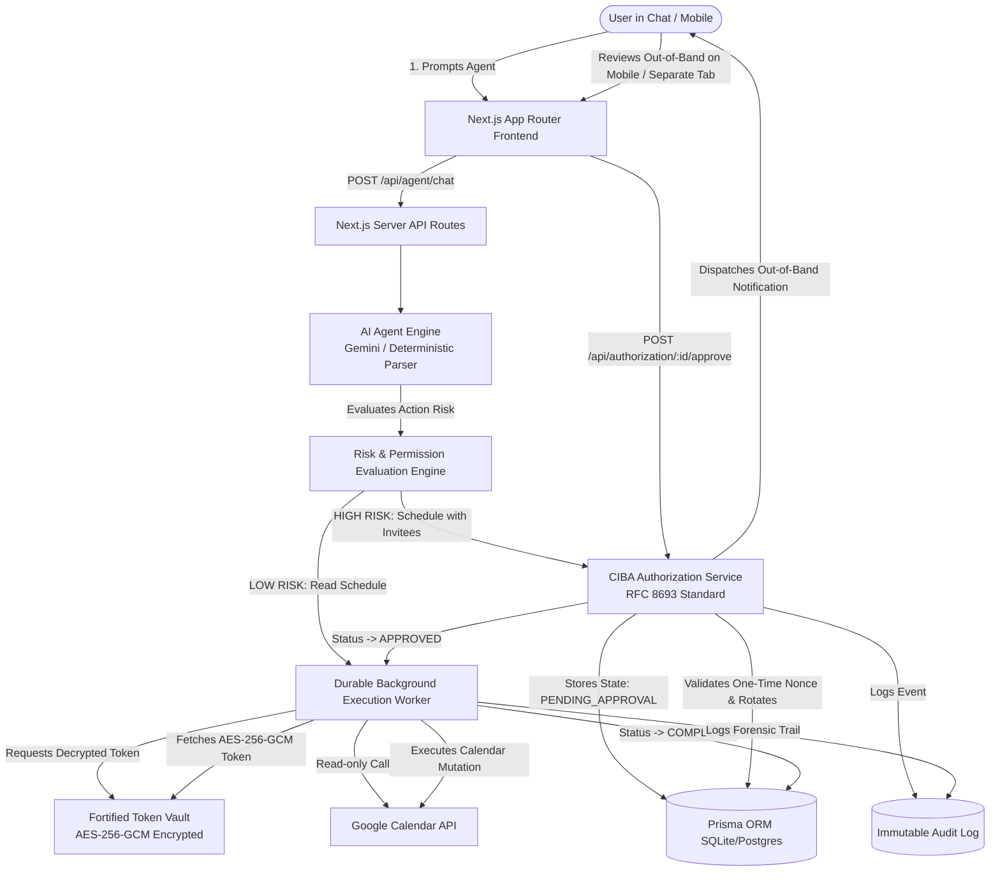
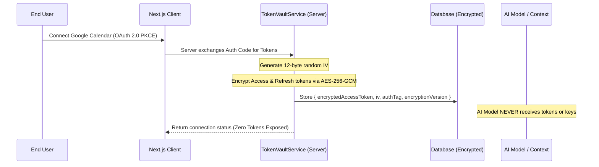
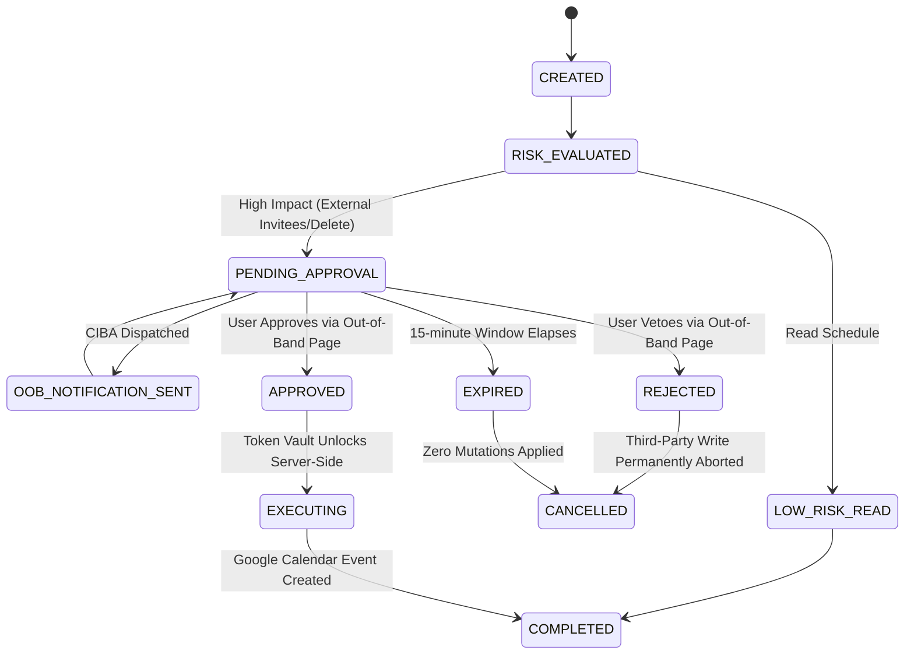

# VETO AGENT — Full-Stack AI Agent with Token Vault & Asynchronous Authorization (CIBA)

> **"Your AI. Your Services. Your Final Say."**
>
> Built for the **MLH Global Hack Week — Builders Week Challenge: The Veto Agent (Focus: Token Vault & Asynchronous Authorization)**.

[](https://github.com)
[](https://nextjs.org)
[](https://csrc.nist.gov/publications/detail/sp/800-38d/final)
[](https://openid.net/specs/openid-client-initiated-backchannel-authentication-core-1_0.html)

---

## 1. Executive Summary & Problem Statement

Modern generative AI assistants are increasingly granted tool-calling access to third-party APIs (calendars, email, code repositories, cloud infrastructure). However, standard implementations suffer from two critical architectural flaws:

1. **Credential Exposure:** Access tokens and API keys are either stored insecurely in plaintext or directly passed into the LLM context window, exposing them to prompt injection, extraction attacks, and client-side leakage.
2. **Unchecked Mutating Authority:** AI models make probabilistic decisions. When an agent creates, modifies, or deletes real-world resources (e.g., booking executive meetings, sending invites to investors, merging pull requests, deleting files), it performs these actions synchronously without explicit human approval.

**VETO AGENT solves this by introducing two non-negotiable security boundaries:**

1. **Centralized Encrypted Token Vault (AES-256-GCM):** The AI model never receives or manipulates OAuth tokens. All credentials reside in an isolated, encrypted vault decrypted strictly server-side by an authorized execution worker.
2. **Decoupled Asynchronous Authorization (RFC 8693 CIBA):** High-impact actions trigger an immediate pause in execution. A backchannel authentication request (`auth_req_id`) is issued, and an out-of-band notification (email/push) is sent to the user. The action executes **only** after explicit human verification on an independent device/page.

---

## 2. System Architecture



---

## 3. The Token Vault: Cryptographic Security

The Token Vault guarantees that third-party credentials cannot be leaked through prompt injection or client-side inspection.



### Cryptographic Guarantees:
- **Cipher:** `AES-256-GCM` (Galois/Counter Mode) authenticated encryption.
- **Initialization Vector (IV):** 12 bytes randomly generated per operation via `crypto.randomBytes(12)`.
- **Integrity Authentication Tag:** 16-byte GCM authentication tag verified on every decryption. Any tampering instantly rejects decryption.
- **Key Derivation:** Ingests 32-byte (64-char hex) master secret from `TOKEN_VAULT_ENCRYPTION_KEY`.
- **Zero Plaintext Guarantee:** Tokens are never sent to the browser, never saved in logs, and never provided to the LLM.

---

## 4. CIBA Asynchronous Authorization Lifecycle



### Risk Evaluation Rules:
1. **LOW RISK (Permitted Immediately):**
   - `get_calendar_events`
   - `search_calendar_events`
   - `find_available_slots`
   - `get_today_schedule`
2. **MEDIUM RISK:**
   - `prepare_calendar_event` (draft staging)
3. **HIGH RISK (Requires Out-of-Band CIBA Authorization):**
   - `create_calendar_event` with external participants or executive titles (e.g. CEO, board, investors)
   - `delete_calendar_event` (irreversible destructive action)

---

## 5. Technology Stack

- **Frontend:** Next.js 15 (App Router), React 19, TypeScript, Tailwind CSS, Lucide React, Framer Motion.
- **Backend:** Next.js Server-Side API routes, Node.js crypto, REST architecture.
- **Database:** Prisma ORM with SQLite (seamless zero-dependency local dev) and PostgreSQL support.
- **Security & Crypto:** Node `crypto` AES-256-GCM, Bcrypt.js, HTTP-Only SameSite cookies, single-use cryptographic approval nonces.
- **AI Engine:**
  - Google Gemini API (`@google/generative-ai` tool-calling support)
  - Deterministic AI Reasoner (100% offline fallback so hackathon judges can test without API keys)
- **Third-Party Integration:** Google Calendar API v3 (live OAuth 2.0 PKCE + pre-seeded demo mode).
- **Decoupled Auth:** OpenID Connect CIBA Core 1.0 backchannel implementation.
- **Testing:** Vitest automated verification suite (7 security and protocol test suites).

---

## 6. Project Structure

```
├── prisma/
│   └── schema.prisma                # Relational schema (Users, Vault, CIBA, Executions, Audit)
├── scripts/
│   └── seed.mjs                     # Pre-seeds demo user, encrypted vault credentials & schedule
├── src/
│   ├── app/
│   │   ├── api/                     # 18 REST endpoints
│   │   │   ├── agent/               # AI chat, history & tool executor
│   │   │   ├── audit/               # Immutable forensic logs
│   │   │   ├── auth/                # Register, login, session, demo quick-login
│   │   │   ├── authorization/       # CIBA start, callback, approve, reject
│   │   │   ├── executions/          # Background worker job queue
│   │   │   ├── integrations/        # Google Calendar OAuth & Demo connections
│   │   │   ├── notifications/       # Outbox email preview
│   │   │   └── vault/               # Token Vault status & token rotation
│   │   ├── approve/[id]/page.tsx    # Mobile-friendly standalone out-of-band approval page
│   │   ├── dashboard/               # Main enterprise dashboard
│   │   │   ├── approvals/page.tsx   # Dedicated Authorization Center
│   │   │   ├── audit/page.tsx       # Security & Compliance Audit Log
│   │   │   ├── chat/page.tsx        # AI Assistant Chat with Pending Approval cards
│   │   │   ├── executions/page.tsx  # Durable Background Worker monitor
│   │   │   ├── integrations/page.tsx# Connected Services (Google Calendar)
│   │   │   ├── settings/page.tsx    # Cryptographic vault parameters & CIBA settings
│   │   │   └── page.tsx             # Overview metrics
│   │   ├── login/page.tsx           # 1-Click Demo Login
│   │   ├── register/page.tsx        # User registration
│   │   └── page.tsx                 # SaaS Landing Page
│   ├── lib/
│   │   ├── audit.ts                 # Sanitized audit logger
│   │   ├── crypto.ts                # AES-256-GCM cipher & nonce generator
│   │   ├── prisma.ts                # Prisma singleton
│   │   └── session.ts               # Secure JWT & HTTP-Only cookie management
│   └── services/
│       ├── ai-agent.service.ts      # Tool-calling AI engine + fallback
│       ├── ciba.service.ts          # RFC 8693 CIBA protocol service
│       ├── execution-worker.service.ts # Durable background job runner
│       ├── google-calendar.service.ts # Google Calendar API + Demo adapter
│       ├── notification.service.ts  # Out-of-band email dispatcher + local outbox
│       ├── risk-evaluation.service.ts # Permission & Risk Engine
│       └── token-vault.service.ts   # Fortified Token Vault service
└── tests/
    └── veto-agent.test.ts           # 7 comprehensive verification tests
```

---

## 7. Setup & Installation

### Prerequisites
- Node.js v18+ (tested on Node v24.22.1)
- npm v10+

### Step 1: Clone and Install Dependencies
```bash
git clone https://github.com/your-username/veto-agent.git
cd veto-agent
npm install
```

### Step 2: Configure Environment Variables
Copy `.env.example` to `.env`:
```bash
cp .env.example .env
```

Your `.env` comes pre-configured with a 32-byte AES-256-GCM encryption key and SQLite database for zero-friction local execution:
```env
APP_BASE_URL="http://localhost:3000"
NEXT_PUBLIC_APP_URL="http://localhost:3000"
DATABASE_URL="file:./dev.db"
JWT_SECRET="veto_agent_jwt_secret_dev_key_secure_session_token_32chars"
TOKEN_VAULT_ENCRYPTION_KEY="d0d509b2abb793af966bbd458baee1a3925a197be298e41e338fd7dbc80a2d68"
DEMO_MODE="true"
```

*(Optional)* To test with live Google Calendar or Gemini:
- Provide `GOOGLE_CLIENT_ID` and `GOOGLE_CLIENT_SECRET`.
- Provide `GEMINI_API_KEY`.
- Provide `RESEND_API_KEY` for live email delivery.

### Step 3: Initialize Database & Seed Demo Data
```bash
npx prisma db push
node scripts/seed.mjs
```

### Step 4: Run the Automated Test Suite
Run the 7 security and CIBA test cases:
```bash
npm test
```
Expected output:
```
✓ tests/veto-agent.test.ts (7 tests)
  ✓ Encrypts and decrypts OAuth tokens using AES-256-GCM with tamper detection
  ✓ Test 1: Read operation retrieves schedule without requiring CIBA authorization
  ✓ Test 2: High-impact operation pauses execution, triggers CIBA, and creates NO calendar event
  ✓ Test 3: External approval resumes execution and creates the event
  ✓ Test 4: External rejection vetoes the action and cancels execution
  ✓ Test 5: Expired authorization request cannot be approved
  ✓ Test 6: Blocks cross-user approval and prevents replay/double execution
```

### Step 5: Start the Application
```bash
npm run dev
```
Open **[http://localhost:3000](http://localhost:3000)** in your browser.

---

## 8. Live Demonstration Guide (For Hackathon Judges)

Follow these steps for a live demonstration of all challenge requirements:

### Step 1: Instant Login
1. Go to `http://localhost:3000/login`.
2. Click the gradient button **"Instant Demo Login (Alex Builder)"**.
3. You will immediately be authenticated and redirected to `/dashboard`.

### Step 2: Verify Token Vault
1. Click **Connected Services** in the sidebar.
2. Note that **Google Calendar** is connected with its credentials sealed in the **AES-256-GCM Token Vault**.
3. Go to **Settings & Vault** to inspect cipher health, IV length (12 bytes), and key verification.

### Step 3: Normal Read Operation (No CIBA Needed)
1. Navigate to **AI Assistant** (`/dashboard/chat`).
2. Click the quick chip: **"Show me my meetings for today."**
3. Notice that the agent immediately calls the `get_calendar_events` tool, retrieves your schedule, and displays it.
4. **Result:** Low-risk read actions execute smoothly without interrupting you.

### Step 4: High-Impact Action (Execution Paused & CIBA Dispatched)
1. Send the command:
   ```
   Schedule a project review with the CEO tomorrow at 3 PM and invite ceo@example.com
   ```
2. **Observe the security engine in action:**
   - The backend risk engine identifies external invitees (`ceo@example.com`).
   - The agent flags the action as **HIGH RISK**.
   - **Execution is PAUSED immediately.**
   - No calendar event is written.
   - An out-of-band notification is generated.
   - A glowing **Authorization Required (CIBA)** card appears in the chat.

### Step 5: Out-of-Band Inspection
1. Click the top-bar button **"OOB Notification Outbox"**.
2. Notice the simulated email that was sent outside the chat session containing the exact meeting parameters, invitees, and single-use link.
3. Click **"Open Mobile Approval Page"** (or open the link in an incognito window / mobile device).

### Step 6: Exercise Final Veto or Grant Approval
1. On the standalone approval page (`/approve/[id]`):
   - Notice that the page works independently of the chat session.
   - Click **"✓ APPROVE ACTION & EXECUTE"**.
2. Watch the background worker resume, retrieve the token from the Token Vault, and create the event.
3. Head back to the chat and ask: *"Show me my meetings for today."*
4. The newly approved CEO review meeting now appears on your calendar!
5. Check **Security Audit** (`/dashboard/audit`) to see the tamper-proof forensic trail.

---

## 9. Security & Anti-Replay Guarantees

| Security Threat | Mitigation Mechanism |
|---|---|
| **Prompt Injection Token Extraction** | LLM model context never receives raw OAuth credentials; tokens reside exclusively in the server-side Token Vault. |
| **Tampered Ciphertext in Database** | AES-256-GCM 16-byte authentication tag verification fails immediately upon any single-bit alteration. |
| **Replay / Double Approval** | Single-use cryptographic nonce (`approvalNonce`) is rotated and invalidated immediately upon first use. |
| **Cross-User Authorization Hijacking** | The authorization resolver strictly verifies that the authenticated user matches the request owner. |
| **Zombie / Stale Pending Actions** | Automatic 15-minute expiration window cancels pending operations before any mutation can occur. |
| **Duplicate Execution** | `AgentExecution.idempotencyKey` prevents duplicate operations from running even if concurrent requests arrive. |

---

## 10. License

MIT License — Built with pride for **MLH Global Hack Week — Builders Week**.

